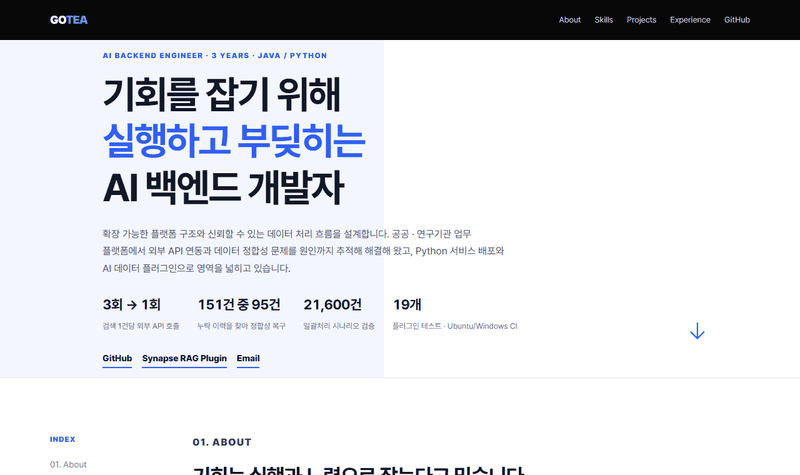
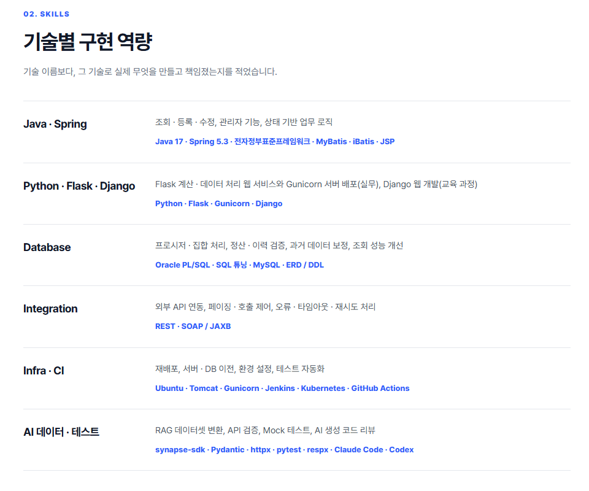
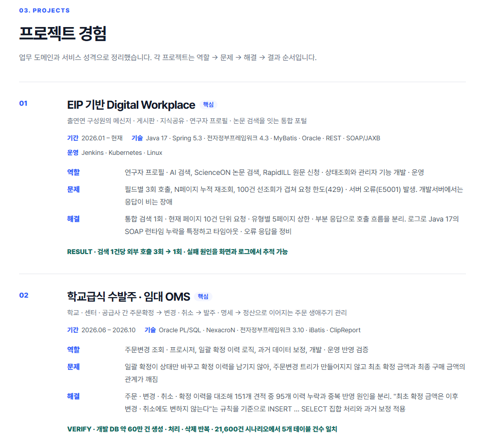
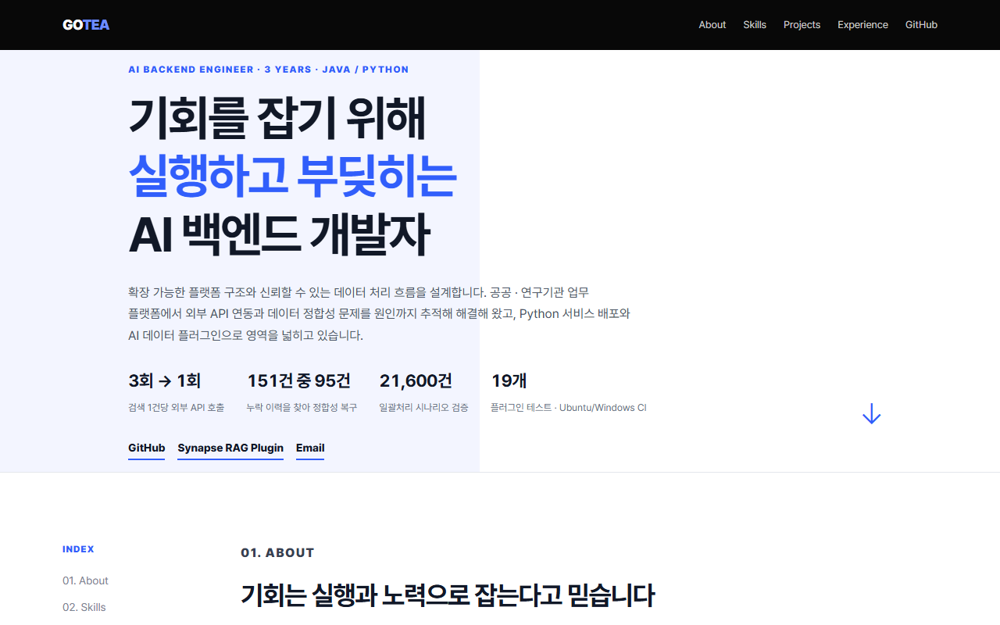
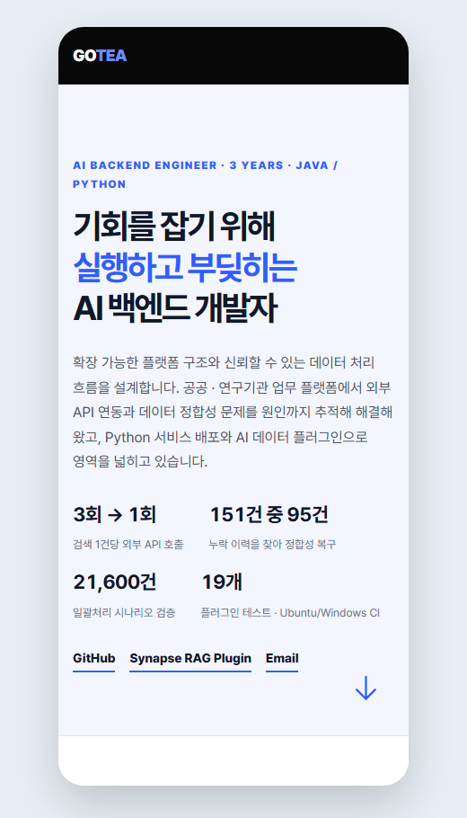

# 고테아 · AI Backend Engineer

**기회를 잡기 위해 실행하고 부딪히는 AI 백엔드 개발자**

확장 가능한 플랫폼 구조와 신뢰할 수 있는 데이터 처리 흐름을 설계합니다.

 

## 👋 About

첫 실무로 Python 웹 서비스 프로젝트를 맡을 기회가 왔을 때, 저는 Flask를 써 본 적이 없었습니다. 책과 공식 문서, 검색, AI로 구조를 익히며 연구진의 C# 계산 엔진을 옮겼고, 원본과 결과가 다르게 나오는 시행착오는 같은 입력으로 대조하며 하나씩 잡았습니다. 그렇게 **고객사 서버로 서비스 이관과 배포를 끝까지 마쳤고**, 이 경험이 지금 일하는 방식의 출발점이 됐습니다.

이후 Java · Spring 기반 연구자 포털과 Oracle PL/SQL 업무 시스템을 개발하며 REST · SOAP API 연동, 상태 · 오류 흐름 설계, 대량 데이터 처리 역량을 키웠습니다. 데이터 불일치나 외부 API 장애는 예외를 우회하기보다 **로그 · 원본 데이터 · 업무 규칙을 함께 확인해 원인을 좁히고**, 검증 가능한 방식으로 개선해 왔습니다.

데이터메이커가 공개한 Synapse SDK로 논문 RAG 데이터셋 플러그인을 만들며, **AI 기능의 품질은 모델뿐 아니라 데이터의 신뢰도와 실행 흐름, 재사용 가능한 인터페이스에 달려 있다**는 것을 배웠습니다.

AI 도구는 구현과 탐색의 생산성을 높이는 데 쓰되, **확보한 시간은 결과물의 재검증과 예외 조건 점검에 씁니다.**

 

## 📊 Highlights

| 성과 | 내용 |
|:---:|---|
| **3회 → 1회** | 검색 1건당 외부 API 호출. 필드별 중복 호출 · 페이지 누적 재조회를 찾아 요청 한도(429) 오류 해소 |
| **151건 중 95건** | 일괄 확정이 남기지 않던 이력을 찾아 주문 금액 정합성 복구 (INSERT … SELECT 집합 처리) |
| **21,600건** | 일괄처리 시나리오에서 주문 · 발주 · 명세 · 이력 등 5개 테이블 건수 일치 검증 |
| **19개 테스트** | Synapse 플러그인 · GitHub Actions(Ubuntu · Windows) CI |

 

## 🛠 Skills

| 영역 | 기술 | 실제로 한 일 |
|---|---|---|
| **Java · Spring** | Java 17, Spring 5.3, 전자정부표준프레임워크, MyBatis, iBatis, JSP | 조회 · 등록 · 수정, 관리자 기능, 상태 기반 업무 로직 |
| **Python** | Python, Flask, Gunicorn, Django | Flask 계산 · 데이터 처리 웹 서비스와 Gunicorn 서버 배포(실무), Django 웹 개발(교육 과정) |
| **Database** | Oracle PL/SQL, SQL 튜닝, MySQL, ERD/DDL | 프로시저 · 집합 처리, 정산 · 이력 검증, 과거 데이터 보정 |
| **Integration** | REST, SOAP/JAXB | 외부 API 연동, 페이징 · 호출 제어, 오류 · 타임아웃 · 재시도 처리 |
| **Infra · CI** | Ubuntu, Tomcat, Jenkins, Kubernetes, GitHub Actions | 재배포, 서버 · DB 이전, 환경 설정, CI |
| **AI 데이터 · 테스트** | synapse-sdk, Pydantic, httpx, pytest, respx, Claude Code, Codex | RAG 데이터셋 변환, API 검증, Mock 테스트, AI 생성 코드 리뷰 |

 

## 💼 Experience

### (주)엑소텍 · 백엔드 개발자 `2023.11 – 현재`
공공 · 연구기관 업무 플랫폼 개발 및 운영

<table>
<tr><td width="34%"><b>EIP 기반 Digital Workplace</b> 2026.01 – 현재</td>
<td>연구자 프로필 · AI 검색, ScienceON 논문 검색(REST), RapidILL 원문 신청(SOAP) 개발 · 운영 
→ 호출 구조 개선으로 검색 1건당 외부 호출 <b>3회 → 1회</b>, Java 17 SOAP 런타임 누락 특정 · 타임아웃 정비 
Java 17 · Spring 5.3 · MyBatis · Oracle · REST · SOAP/JAXB · Jenkins · Kubernetes</td></tr>
<tr><td><b>학교급식 수발주 · 임대 OMS</b> 2026.06 – 2026.10</td>
<td>주문변경 조회 · 프로시저, 일괄 확정 이력 로직, 과거 데이터 보정 
→ 확정 이력 미기록을 찾아 집합 처리로 보완, 151개 견적 중 <b>95개 이력 누락</b> 원인 분리 · <b>21,600건</b> 시나리오 검증 
Oracle PL/SQL · NexacroN · 전자정부프레임워크 3.10 · iBatis</td></tr>
<tr><td><b>공공 연구기관 통합 업무 시스템 재구축</b> 2024.09 – 2025.11 · 파견 상주</td>
<td>기존 웹 서비스를 Nexacro · Java 구조로 재구성해 재배포, 기능 단위 영향 범위 검증 
Nexacro · Java · SQL</td></tr>
<tr><td><b>지자체 민간주차장 통합 운영 · 정보 연계</b> 2024.01 – 2024.12</td>
<td>운영 화면 유지보수, ERD · 설정 관리, 데이터 수집 Agent의 OS별 설정 분리 · Runnable JAR 배포 
Java · Spring Boot · Thymeleaf · Oracle · REST · Tomcat</td></tr>
<tr><td><b>Research Engineering Calculation Platform</b> 2023.11 – 2023.12</td>
<td>연구진의 C# 계산 프로그램을 Python 웹 서비스로 이식, 결과 대조로 이식 오류 수정, 대학 서버 이전 · Flask/Gunicorn 배포 문서화 
Python · Flask · MySQL · Ubuntu · Gunicorn</td></tr>
</table>

### 홍익대학교 · 빅데이터 분석 기반 비즈니스 개발자 양성과정 `2023.04 – 2023.11`
Python 웹 개발(Django · Flask), 데이터 분석, 머신러닝 · 딥러닝 기반 프로젝트 수행

 

## 🚀 Personal Project

### [Paper RAG Dataset — Synapse Plugin](https://github.com/vero-zero/synapse-paper-rag-plugin)
데이터메이커 공개 Synapse SDK로 오픈액세스 논문을 수집 · 정제해 **RAG 청크 데이터셋과 품질 리포트**로 변환하는 플러그인

- DOI 중복 제거 · 문장 단위 청크 + overlap · 출처 메타데이터 · 품질 manifest
- 영문 30편 → 94청크 · 한국어 20편 → 35청크 · 테스트 19개 (Ubuntu · Windows CI)
- 한국어 Windows에서만 SDK가 설정 파일을 못 읽는 문제(cp949)를 찾아 기록

 

## 🖥 Screenshots

| Skills | Projects |
|:---:|:---:|
|  |  |

| Desktop | Mobile |
|:---:|:---:|
|  |  |

 

## ✍️ Working Principle

> **AI로 빨라진 만큼, 확보한 시간은 리뷰에 씁니다.**
> AI 도구는 탐색과 구현 초안의 속도를 높이는 데 활용하고, 그렇게 얻은 시간은 데이터 흐름 · 예외 조건 · 변경 영향과 결과를 직접 검증하는 데 씁니다.

 

---

이 저장소는 GitHub Pages로 배포되는 포트폴리오 사이트(`index.html`)입니다. 빌드 과정 없이 정적 HTML 하나로 동작합니다.
